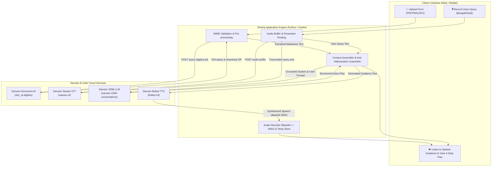
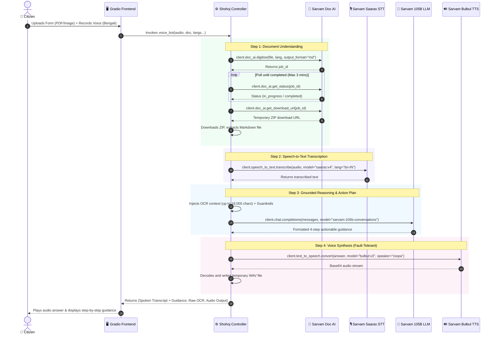

# Shohoj (সহজ) — Civic AI Voice & Document Assistant

> **Making Complex Government Documents Simple & Actionable**  
> *জটিল সরকারি নিয়ম ও ফর্ম সহজ ভাষায় সবার কাছে পৌঁছে দেওয়ার এক কৃত্রিম বুদ্ধিমত্তা প্রয়াস।*

<p align="center">
  
  
  
  
  
  
</p>

---

## 📌 Project Overview

**Shohoj (সহজ)** is an Indic-first, voice-enabled civic AI assistant engineered to dismantle linguistic, administrative, and literacy barriers in public welfare and government application processes.

Every year, millions of citizens—particularly across rural and semi-urban communities—miss out on critical social welfare schemes, pensions, healthcare subsidies, and citizen services due to:
* Dense administrative jargon and complicated multiform requirements.
* Language and literacy hurdles where written instructions are inaccessible.
* Confusion regarding required supporting documents, eligibility criteria, and submission centres.

Shohoj bridges this digital divide. A citizen can simply **upload an official government form or scheme flyer** (PDF, PNG, or JPG) and **speak their personal situation or question in their mother tongue** (Bengali or Hindi). Shohoj extracts and understands the document via Sarvam Document AI, transcribes their spoken words with Sarvam Saaras STT, derives grounded, actionable next steps through Sarvam-105B, and speaks the guidance back aloud using Sarvam Bulbul TTS.

---

## 🌟 Key Features

* **📄 Multimodal Document Digitisation & OCR:**
  Seamlessly extracts text and structural layout from uploaded government documents (supporting multi-page PDFs up to 10 pages, PNG, and JPG images) using Sarvam Document AI, outputting structured Markdown.

* **🎙️ Voice-First Spoken Query Ingestion:**
  Enables citizens to describe their circumstances naturally via voice recording (up to 30 seconds) in regional languages (`bn-IN` Bengali, `hi-IN` Hindi) powered by Sarvam's high-accuracy `saaras:v4` Speech-to-Text model.

* **🧠 Context-Grounded Civic Reasoning (Anti-Hallucination):**
  Orchestrates the `sarvam-105b-conversations` large language model with strict guardrails: the AI anchors its advice solely on the uploaded document's contents, never invents non-existent eligibility criteria or fees, and produces a concrete 4-step action plan.

* **🔊 Natural Indic Speech Synthesis:**
  Converts the synthesized advice into human-like spoken audio using Sarvam's `bulbul:v3` Text-to-Speech model (`roopa` voice) so non-literate or visually impaired users can listen to their personalized instructions.

* **🌐 Bilingual, High-Accessibility UI:**
  Features a responsive, civic-themed web interface crafted in Gradio with custom CSS glassmorphism, bilingual typography (`Hind Siliguri` & `Plus Jakarta Sans`), dual-language labels, and color-coded progress cards.

* **🛡️ Resilient & Transparent Design:**
  * **Audio Fallback:** Written guidance remains accessible even if audio synthesis encounters rate-limits or network interruptions.
  * **Inspection Accordion:** Raw extracted OCR text is inspectable in a collapsible panel for full auditing and transparency.
  * **Civic Disclaimer:** Built-in safeguards remind users to cross-verify specific dates and submissions at their local administrative office.

---

## 🛠️ Comprehensive Tech Stack

### Technology Matrix

| Layer / Domain | Technology / Service | Identifier / Version | Role & Description |
|---|---|---|---|
| **User Interface** | [Gradio](https://gradio.app/) | `^4.0+` | Interactive, responsive web application framework |
| **Styling & Typography** | Modern CSS3 & Google Fonts | `Hind Siliguri`, `Plus Jakarta Sans` | Glassmorphic civic design system, emerald palette, bilingual font stack |
| **Backend Runtime** | Python | `3.10+` | Core asynchronous workflow execution and orchestration |
| **API Client SDK** | Sarvam AI SDK | `sarvamai` | Unified SDK client interfacing with all Sarvam AI Indic endpoints |
| **Document AI (OCR)** | Sarvam Document AI | `doc_ai.digitise` | Asynchronous document text and structural layout extraction (Markdown format) |
| **Speech-to-Text (STT)** | Sarvam Saaras | `saaras:v4` | High-fidelity Indic voice transcription (`bn-IN`, `hi-IN`) |
| **Reasoning Engine (LLM)** | Sarvam Conversations | `sarvam-105b-conversations` | 105B-parameter reasoning model for contextual grounding and action plans |
| **Text-to-Speech (TTS)** | Sarvam Bulbul | `bulbul:v3` (`roopa` voice) | Natural Indic voice synthesis converting advice into spoken audio |
| **HTTP & File IO** | Requests, Mimetypes, Zipfile | Built-in / `requests` | Asynchronous poll retrieval, MIME sniffing, and ZIP package extraction |
| **Configuration** | Python Dotenv | `python-dotenv` | Secure environment variable and credential management |

---

## 🏗️ System Architecture & System Design

### High-Level Architecture



### End-to-End Execution Sequence



### Key System Design Principles

1. **Document Grounding & Context Windowing:**  
   Government documents often feature complex tables and long legal notices. Shohoj extracts Markdown to retain heading and tabular structures, passing up to 18,000 characters into the context window of `sarvam-105b-conversations`.
2. **Strict Anti-Hallucination Guardrails:**  
   The system prompt explicitly commands the LLM to treat the document as the sole authoritative reference for its content, prohibiting fabricated addresses, eligibility assumptions, fees, or procedural guarantees.
3. **Asynchronous Polling with Graceful Timeout:**  
   The OCR pipeline safely polls the Sarvam Document AI job queue up to 36 cycles (approx. 3 minutes) with backoff before downloading and unpacking the resulting ZIP payload.
4. **Decoupled Audio Generation:**  
   The TTS synthesis step is isolated in a separate try-except block. If speech generation encounters rate limiting, the written action plan is preserved without interruption.

---

## 📡 API Overview & Documentation

Shohoj orchestrates four distinct Sarvam AI services through the official `sarvamai` Python SDK.

### 1. Document AI (OCR & Digitisation)
* **Client Method:** `client.doc_ai.digitise(...)`
* **Status Method:** `client.doc_ai.get_status(job_id=...)`
* **Download Method:** `client.doc_ai.get_download_url(job_id=...)`
* **Supported Formats:** PDF (`application/pdf`), PNG (`image/png`), JPG/JPEG (`image/jpeg`)
* **Output Format:** Structured Markdown (`md`) or plain text (`txt`) packed in a ZIP archive.

```python
# Launch asynchronous digitisation
job = client.doc_ai.digitise(
    file=[(filename, file_handle, content_type)],
    language="bn-IN",      # "bn-IN", "hi-IN", or "en-IN"
    output_format="md"
)

# Poll for completion and retrieve download URL
status = client.doc_ai.get_status(job_id=job.job_id)
download = client.doc_ai.get_download_url(job_id=job.job_id)
```

### 2. Speech-to-Text (STT)
* **Client Method:** `client.speech_to_text.transcribe(...)`
* **Model:** `saaras:v4`
* **Languages:** Bengali (`bn-IN`), Hindi (`hi-IN`)
* **Input:** Audio file (WAV, MP3, etc. recorded via microphone or uploaded).
* **Limit:** Up to 30 seconds per interactive synchronous query.

```python
with open("user_audio.wav", "rb") as audio:
    stt_response = client.speech_to_text.transcribe(
        file=audio,
        model="saaras:v4",
        language_code="bn-IN",
        mode="transcribe"
    )

transcript = stt_response.transcript
```

### 3. Conversational Reasoning (LLM)
* **Client Method:** `client.chat.completions(...)`
* **Model:** `sarvam-105b-conversations`
* **System Prompt Strategy:** Strict 4-part structured response:
  1. *What the document is about*
  2. *What the user should do next*
  3. *Which documents may be needed (if confirmed)*
  4. *What needs official verification*

```python
chat_response = client.chat.completions(
    model="sarvam-105b-conversations",
    messages=[
        {"role": "system", "content": system_prompt_with_rules},
        {"role": "user", "content": f"DOCUMENT:\n{doc_text}\n\nUSER QUESTION:\n{transcript}"}
    ]
)

answer = chat_response.choices[0].message.content
```

### 4. Text-to-Speech (TTS)
* **Client Method:** `client.text_to_speech.convert(...)`
* **Model:** `bulbul:v3`
* **Speaker:** `roopa`
* **Languages:** Bengali (`bn-IN`), Hindi (`hi-IN`)
* **Output:** Base64-encoded audio stream (`audio/wav`).

```python
tts_response = client.text_to_speech.convert(
    text=answer,
    language_code="bn-IN",
    model="bulbul:v3",
    speaker="roopa"
)

audio_bytes = base64.b64decode(tts_response.audios[0])
```

---

## 📁 Project Structure

```text
shohoj/
├── app.py                  # Core Gradio web application with custom UI & orchestration
├── voice_bot.py            # Standalone CLI voice-in / voice-out terminal demo
├── generate_voice.py       # Helper script to synthesize Bengali test queries
├── requirements.txt        # Python package dependencies
├── .env.example            # Template for environment variables
├── .env                    # Local secrets (API key — git-ignored)
├── .gitignore              # Git ignore rules for virtualenvs and secrets
├── README.md               # Complete project documentation
├── tests/                  # Integration & unit test scripts
│   ├── test.py             # Basic Sarvam-105B LLM connection verification
│   ├── stt_test.py         # Saaras:v4 Speech-to-Text audio transcription test
│   └── tts_test.py         # Bulbul:v3 Text-to-Speech synthesis test
└── utils/                  # Sample audio assets for testing and benchmarks
    ├── question.wav        # Sample recorded citizen question
    ├── answer.wav          # Sample synthesized audio response
    └── user_question.wav   # Bengali synthetic test speech sample
```

---

## 🚀 Installation and Setup

### Prerequisites

* **Python 3.10** or higher installed on your system.
* **Git** installed on your system.
* A valid **Sarvam AI API Key** (obtainable from the [Sarvam AI Dashboard](https://dashboard.sarvam.ai/)).

### Step 1: Clone the Repository

```bash
git clone https://github.com/Soupal23/shohoj.git
cd shohoj
```

### Step 2: Create and Activate a Virtual Environment

**On Linux / macOS:**
```bash
python3 -m venv venv
source venv/bin/activate
```

**On Windows (PowerShell):**
```powershell
python -m venv venv
.\venv\Scripts\Activate.ps1
```

### Step 3: Install Dependencies

```bash
pip install -r requirements.txt
```

### Step 4: Configure Environment Variables

Copy the template `.env.example` file to create your active `.env`:

```bash
cp .env.example .env
```

Open `.env` in any text editor and supply your Sarvam AI API subscription key:

```env
SARVAM_API_KEY=your_actual_sarvam_api_key_here
```

> [!WARNING]
> Never commit your `.env` file or expose your API subscription key publicly.

### Step 5: Verify the Integration (Optional)

Test your API credentials and services using the included test suite:

```bash
# 1. Test LLM Chat Completion
python tests/test.py

# 2. Test Speech-to-Text
python tests/stt_test.py

# 3. Test Text-to-Speech
python tests/tts_test.py
```

### Step 6: Launch the Web Application

Run the application with:

```bash
python app.py
```

Once launched, open your web browser and navigate to the local Gradio interface:
```text
http://127.0.0.1:7860
```

---

## 🛡️ Responsible AI & Civic Disclaimer

Shohoj is designed as an accessibility bridge to assist citizens in understanding administrative documents. It does **not** replace official government bodies, designated officers, or legal council. Scheme guidelines, eligibility rules, application deadlines, and required documentation are subject to government amendments. Users should always confirm critical requirements with the respective government department or an authorized service centre (e.g., Bangla Sahayata Kendra / CSC) prior to formal submission.
